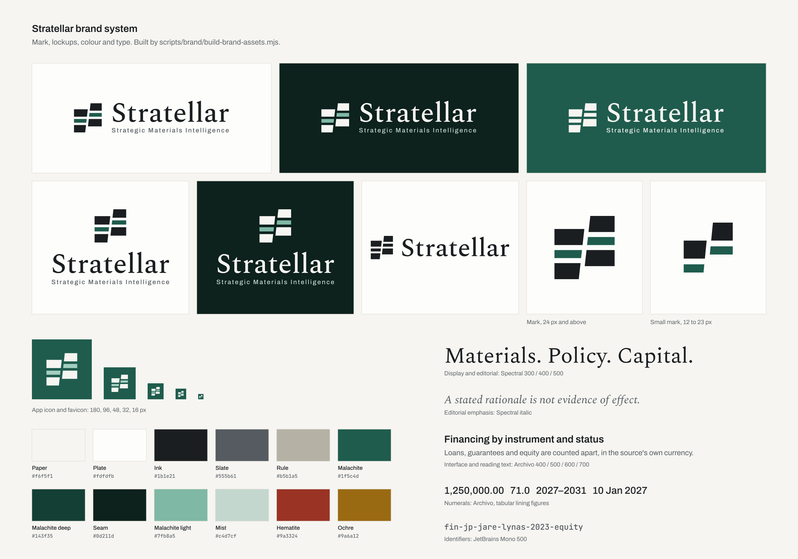
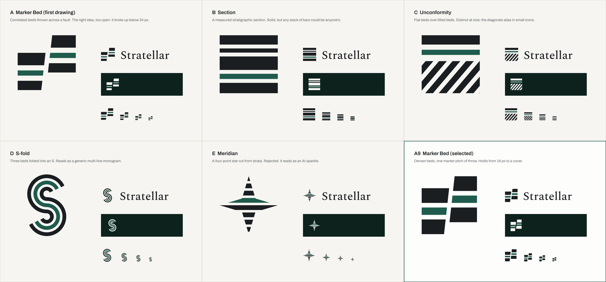

# Stratellar brand system

Version 1.0 · 24 November 2026 · See the [production cutover record](STRATELLAR_CUTOVER.md).

| | |
| --- | --- |
| Name | **Stratellar** |
| Descriptor | **Strategic Materials Intelligence** |
| Tagline | **Materials. Policy. Capital.** |
| Production domain | `stratellar.com` |
| Source of truth in code | `lib/site.ts` (name, descriptor, tagline), `lib/brand-mark.ts` (mark), `app/globals.css` (colour), `docs/design/publication-tokens.json` (off-site colour) |
| Asset build | `npm run brand:build` regenerates the brand artwork and the copies the site serves |

Stratellar is a publishing name. It is not described anywhere as an incorporated company, a firm with clients or a licensed adviser. Trademark clearance and domain acquisition are separate launch dependencies and are not established by this document.



## 1. The idea

Stratellar reads the record in layers. A policy measure sits above the financing that follows it, the financing above the project it funds, and the project above what is physically built. The name carries that idea in its first syllable, *strata*, and the identity draws it directly.

The work the site does is correlation: finding the same instrument, commitment or project across documents that were written at different times by different authorities, and showing where the record breaks. Geologists do the same thing with a **marker bed**, a thin, distinctive layer that can be matched from one side of a fault to the other. The mark is that figure.

The site remains a light drawing sheet with square corners, hairline rules, an editorial serif and one green. The rebrand adds a name, a mark, a dark ground for covers and a set of applications. It keeps the Architectural Research Studio system described in [the design system](../design/ARCHITECTURAL_RESEARCH_STUDIO.md) and changes none of its layout rules.

## 2. Logo

### 2.1 Concepts considered



| | Concept | Assessment |
| --- | --- | --- |
| A | Marker Bed, first drawing | Correlated beds thrown across a fault. The right idea, drawn too open: it broke up below 24 px. |
| B | Section | A measured stratigraphic section. Solid at every size, but a stack of bars could belong to anyone. |
| C | Unconformity | Flat beds over tilted beds. Distinct at size; the diagonals alias in small icons. |
| D | S-fold | Three beds folded into an S. Reads as a generic multi-line monogram. |
| E | Meridian | A four-point star cut from strata. Rejected: it reads as an AI sparkle. |
| **A9** | **Marker Bed, selected** | Denser beds and a throw of exactly one marker pitch. Holds from 16 px to a cover. |

### 2.2 The mark

Two identical bed sequences sit either side of a slanted fault. The right block is thrown up by one marker pitch, so the thin green bed on the left lines up with the gap above the green bed on the right. The eye matches the two green beds across the break; that act of matching is the subject.

- Construction: three beds of 16, 8 and 16 units with 5-unit gaps, a 13-unit throw, a 4.5-unit fault leaning 7 units over the height, on a 60-unit width (`MARK` in `lib/brand-mark.ts`).
- Small form: a two-bed reduction (`MARK_SMALL`) for 12 to 23 px. Use it for favicons and dense interface chrome.
- The beds take the text colour of the surface. The marker bed takes the accent. Nothing else in the mark is coloured.
- The React component (`components/ui/brand.tsx`), the vector masters and the icons all draw from the same geometry, so they cannot drift. `tests/brand-system.test.ts` checks it.

### 2.3 Wordmark and lockups

The name is set in **Spectral Medium**, sentence case, tracked +0.004 em. On the site it is live text. In the asset files it is converted to outlines, so each SVG is editable without the font installed.

| Lockup | File stem (`brand/logo/`) | Use |
| --- | --- | --- |
| Horizontal | `stratellar-lockup-horizontal-*` | Site header, document running heads, anywhere the surrounding context already says what Stratellar is |
| Horizontal with descriptor | `stratellar-lockup-horizontal-descriptor-*` | Footers, covers, cards, first appearance in a document |
| Stacked | `stratellar-lockup-stacked-*` | Square and portrait formats, title pages, profile-adjacent artwork |
| Mark | `stratellar-mark-*`, `stratellar-mark-small-*` | Icons, avatars, tight spaces where the name is given nearby in text |
| Wordmark | `stratellar-wordmark-*` | Where the mark already appears separately on the same surface |

The lockups and the mark exist in four tones, as SVG and as PNG (`brand/logo/png/`). The wordmark alone is supplied in `ink` and `paper`, since it carries no marker bed, and the small mark as SVG:

| Tone | Beds and name | Marker | Ground |
| --- | --- | --- | --- |
| `colour` | Graphite | Malachite | Paper, Chalk, white |
| `ink` | Graphite | Graphite | Single-colour print, fax-grade reproduction, embossing |
| `reversed` | Paper | Malachite Light | Seam, Malachite, dark photography |
| `paper` | Paper | Paper | Single-colour on any dark ground |

### 2.4 Clear space and minimum size

- Clear space: the height of the marker bed pair, in practice one quarter of the mark's height, on every side of a lockup.
- Minimum size, full mark: 24 px or 8 mm high. Below that, use the small form.
- Minimum size, small form: 12 px. Below that, do not use a mark; set the name in text.
- Minimum size, horizontal lockup: 96 px or 30 mm wide. With descriptor: 160 px or 48 mm wide, so the descriptor stays above 7 pt.

### 2.5 Do not

- Recolour the beds, or colour more than the marker bed.
- Rotate, skew, outline, shadow or animate the mark.
- Set the name in another typeface, in capitals, or with letterspacing.
- Place the colour lockup on a mid-tone or busy ground; use a reversed or paper tone on a Seam or Malachite field.
- Attach the tagline to the lockup as a third line. The tagline is set apart from the logo, in Spectral, with its three full stops.
- Pair the mark with a sparkle, a pickaxe, a globe or a hexagon grid.

## 3. Colour

Malachite stays the brand's one green. The rebrand adds a dark ground and four supporting tones around it and leaves the site's reading palette as it was.

| Token | Hex | Site variable | Role |
| --- | --- | --- | --- |
| Paper | `#f6f5f1` | `--bg` | Page ground |
| Chalk | `#fbfaf7` | `--surface` | Raised surfaces |
| Plate | `#fdfdfb` | `--plate` | Exhibit and chart ground |
| Elevated | `#eeece5` | `--elevated` | Bands, inset panels |
| Graphite | `#1b1e21` | `--fg` | Text, the mark's beds, the name |
| Slate | `#555b61` | `--muted` | Secondary text, the descriptor |
| Faint | `#61666c` | `--faint` | Tertiary text |
| Rule | `#dbd8cf` | `--border` | Hairlines |
| Rule strong | `#b5b1a5` | `--border-strong` | Emphasised rules |
| **Malachite** | `#1f5c4d` | `--accent` | The marker bed, links, the one emphasised mark in an exhibit, icon ground |
| Malachite Deep | `#143f35` | `--accent-strong` | Pressed and hover states, small green text |
| **Seam** | `#0d211d` | `--seam` | Dark ground for covers, social cards and reversed lockups |
| Seam Bed | `#143029` | `--seam-bed` | Strata drawn on a Seam ground |
| Malachite Light | `#7fb8a5` | `--malachite-light` | The marker bed and accents on Seam |
| On Malachite | `#a3cfc0` | `--on-malachite` | The marker bed on a Malachite ground (icons) |
| Mist | `#c4d7cf` | `--malachite-mist` | Secondary text on Seam |
| Tint | `#e6ede9` | `--malachite-tint` | Light green panels, callouts in documents |
| Hematite | `#9a3324` | `--negative` | Negative values, ended or withdrawn status |
| Ochre | `#9a6a12` | `--ochre` | Rules and markers only |

Rules of use:

1. The site is a light sheet. Seam is for covers, social artwork, document title pages and reversed lockups. It is not an interface theme.
2. One green per composition carries meaning. On a light ground that is Malachite; on Seam it is Malachite Light.
3. Status colours (Hematite, Ochre) keep the meanings the data pages already give them. They are never decoration.
4. Chart series colours come from the categorical set in `docs/design/publication-tokens.json` and `components/markets/types.ts`. Brand colours do not replace them.

Measured contrast (WCAG 2.x):

| Pair | Ratio | Passes |
| --- | --- | --- |
| Graphite on Paper | 15.35 | AAA |
| Slate on Paper | 6.30 | AA |
| Faint on Paper | 5.31 | AA |
| Malachite on Paper | 7.14 | AAA |
| Paper on Seam | 15.37 | AAA |
| Mist on Seam | 11.15 | AAA |
| Malachite Light on Seam | 7.43 | AAA |
| Paper on Malachite | 7.14 | AAA |
| On Malachite on Malachite | 4.54 | AA; used for the icon's marker bed, a graphic |
| Ochre on Paper | 4.33 | Graphic use only; never small text |

## 4. Typography

| Face | Role | Weights |
| --- | --- | --- |
| **Spectral** | The name; editorial titles; standfirsts; pull figures on covers | 400, 400 italic, 500 |
| **Archivo** | Interface, body copy, tables, labels, the descriptor, documents and decks | 400, 500, 600, 700 |
| **JetBrains Mono** | Identifiers, dates in data rails, literal URLs, document references | 500 |

- Hierarchy on the site follows the existing scale: Spectral for the page title and standfirst, Archivo for everything else. `tests/typography.test.ts` enforces the split.
- Labels are sentence case. Small capitals and wide tracking are not used for labels; the descriptor under the logo is the single tracked line, and it is tracked only to match the width of the name.
- Numbers in tables and exhibits use tabular figures.
- The font files used to outline the logo assets are bundled in `assets/fonts/` under the SIL Open Font License; their licence files sit beside them.

## 5. Layout and graphic language

- **Square corners.** No radius on cards, buttons, images or icons. The maskable app icon is the one asset a platform may round.
- **Hairlines.** One-pixel rules in Rule or Rule strong separate content. Shadows are not used.
- **Strata bands.** Covers and social cards carry a band of beds built with the same construction as the mark (`markerBed` with a wide width and an off-centre fault). A band always includes exactly one marker bed and one fault. It runs along an edge and never sits behind text.
- **Spacing.** A 4 px base. Lockup gaps, card padding and cover margins are multiples of it; covers use 64 px margins at 1200 px wide and scale proportionally.
- **Photography.** Documentary images with registered provenance only, as the automatic cover policy requires. No stock mining imagery, no synthetic imagery, no geographically misleading photographs.
- **Charts.** Unchanged. Exhibits keep their plate ground, direct labels, source lines and status vocabulary.

## 6. Voice

The [research publication house style](../research/SMPT_RESEARCH_PUBLICATION_HOUSE_STYLE.md) governs all public copy and is unchanged by the rebrand. Three points apply to the brand itself:

- Describe what a page or product contains. Stratellar does not describe itself with superlatives.
- The descriptor is the standing explanation of the name. Use it wherever the name appears without context, and do not write alternative descriptors.
- The tagline names the three subjects the record connects: materials, policy and capital. Set it whole, in that order and with its full stops, where a card, banner or cover has room for a display line. Do not reorder or extend it, and do not use it as a caption beside a chart or a dated measure.

## 7. Applications

| Application | Files | Size |
| --- | --- | --- |
| Favicon | `app/favicon.ico`, `brand/icons/stratellar-icon-16/32/48.png`, `stratellar-icon-small.svg` | 16, 32, 48 px (small form) |
| App icons | `app/icon.png`, `app/apple-icon.png`, `public/brand/icon-192.png`, `icon-512.png`, `icon-maskable-512.png`; masters in `brand/icons/` up to 1024 px | 512, 180, 192, 512 px |
| Web manifest | `app/manifest.ts` | Paper theme and background |
| Default social card | `public/brand/social/og-default.png` (served at `/opengraph-image`) | 1200 × 630 |
| Homepage card | `brand/social/og-home.png` | 1200 × 630 |
| Research cards | `brand/social/research/<slug>.png`; template `brand/templates/research-card-1200x630.*` | 1200 × 630 |
| LinkedIn profile image | `brand/social/linkedin-profile-800.png`, `-400.png` | 800 × 800, 400 × 400 |
| LinkedIn company banner | `brand/social/linkedin-company-banner-1512x256.png`, `-2256x382.png`, `-1128x191.png` | 1512 × 256 (current upload), 2256 × 382, 1128 × 191 |
| LinkedIn personal banner | `brand/social/linkedin-personal-banner-1584x396.png` | 1584 × 396 |
| Research announcement | `brand/templates/research-announcement-1200x1200.*` | 1200 × 1200 |
| Publication cover | `brand/templates/publication-cover-letter.*` | US Letter |
| Commercial document cover | `brand/templates/document-cover-letter.*` | US Letter |
| Letterhead | `brand/templates/letterhead-letter.*` | US Letter |

Every SVG is an editable vector with outlined text. Every PNG is rendered from its SVG at the size its platform displays.

### 7.1 Research cards and the editorial gate

A card states a study's title, category, date and byline exactly as the research index does (`tests/brand-system.test.ts` compares them). Four published research pages serve their own card from `app/research/<slug>/opengraph-image.tsx`, which returns the file in `public/brand/social/research/` unchanged: the China suspension study, FI001 (Hemerdon), the antimony study and the tungsten study. Pointing a page at its card changes that page's metadata, so the change is held by the editorial gate until the page's review record is signed by a human reviewer. FI002 (Escondida) previews with the default card, as PR #290 set it on 23 November 2026; its drawn card stays under `brand/social/research/` and is not served.

### 7.2 Documents and decks

- New memos and report covers come from `scripts/publication/` (`cover.py`, `memo.py`), which now set the Stratellar masthead and document metadata.
- New decks come from the exhibit system (`scripts/exhibit-system/`) and the master template (`docs/design/presentations/templates/create_master.py`). Both name the theme "Stratellar Studio".
- A study released before the name change keeps its files as issued. If it is reissued in the new identity, the reissue is a new, dated edition that states it is a reissue and links the original; the original stays available at its existing address.

## 8. Earlier name

The project published as Strategic Materials Policy Tracker until the Stratellar launch. The earlier name is kept only where it carries provenance or keeps a reference working:

- in the files of research released under it (`public/research/**`), which are unchanged byte for byte;
- in the suggested citation of each such study, beside the new name;
- in `alternateName` in the site's structured data, so indexes and citations made under the earlier name still resolve;
- in identifiers, file names and addresses listed in the cutover checklist's register.

The earlier lattice mark is archived at `brand/legacy/smpt-lattice-mark.png` and is no longer served.

## 9. Rebuilding and changing the system

```bash
npm run brand:build   # regenerates brand/, public/brand/ and the app icons from lib/brand-mark.ts and assets/fonts/
npm test              # tests/brand-system.test.ts checks names, colours, sizes and card facts
```

To change a colour, edit `app/globals.css`, the `COLOR` table in `scripts/brand/build-brand-assets.mjs` and the `brand` section of `docs/design/publication-tokens.json` together; the test fails if they differ. To change the mark, edit `lib/brand-mark.ts` and rebuild. To change the name, descriptor or tagline, edit `lib/site.ts` and `BRAND` in the generator.
