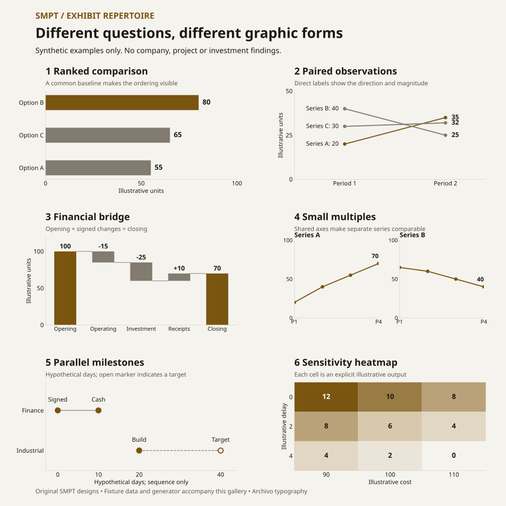
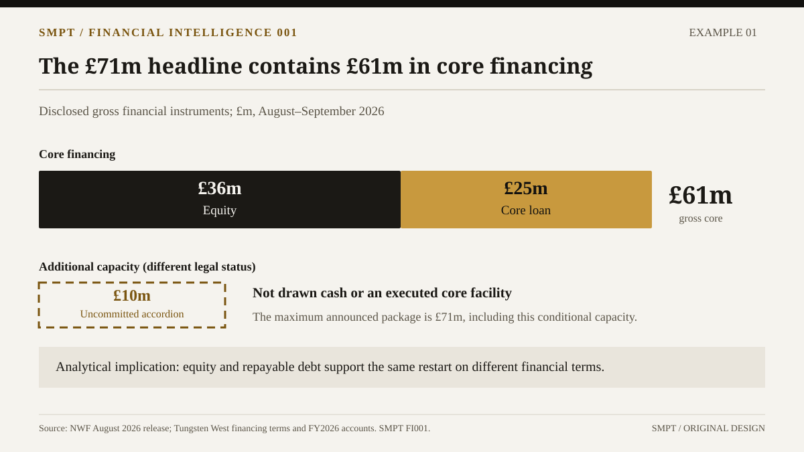
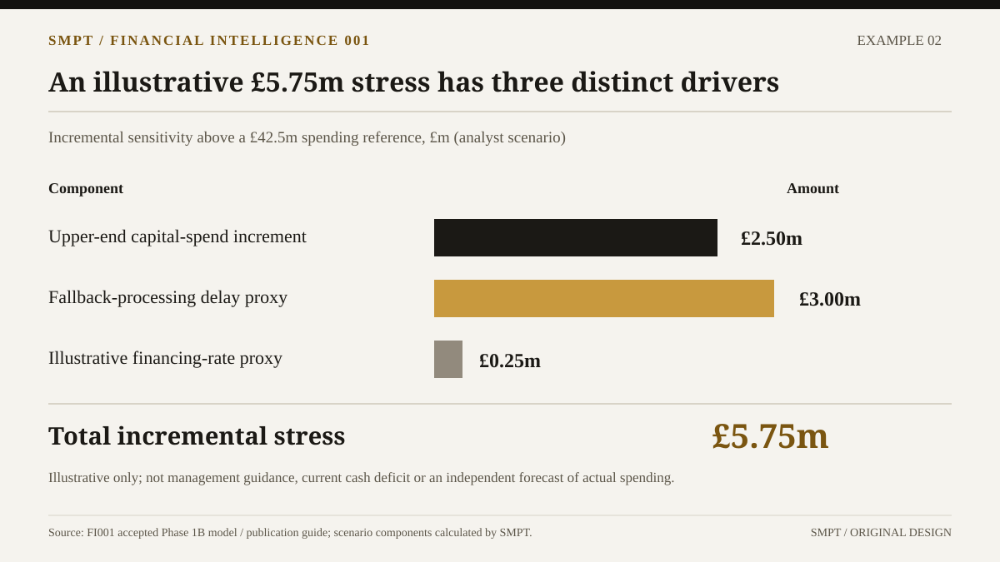
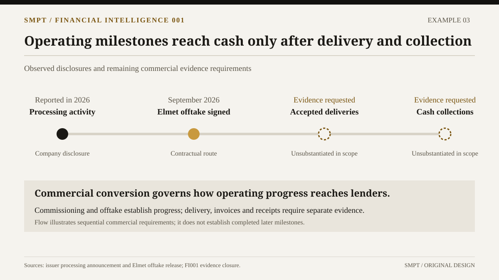
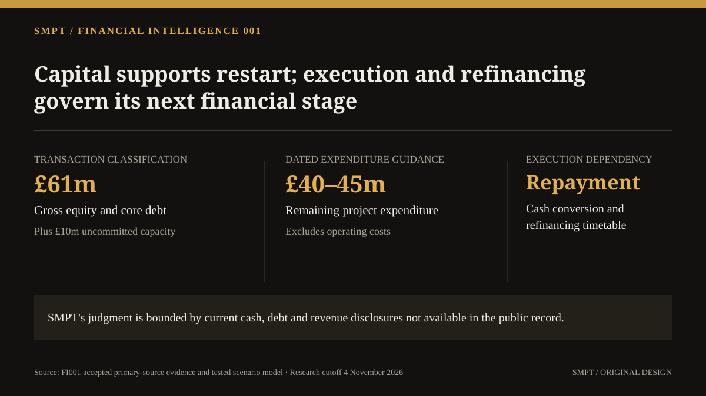

# SMPT presentation system — version 2.2

**Status:** Adopted editorial design standard for new SMPT decks, 5 November 2026; visual repertoire extended 6 November 2026
**Owner:** SMPT editorial/research lead  
**Scope:** Executive briefings, applied-strategy cases, financial-intelligence cases, and visual research dossiers  
**Primary typeface:** Archivo Regular/Medium/Semibold for all new or revised decks. Render PDFs with the same embedded family and preserve native editable charts and source hyperlinks.

**Hard ceiling:** **20 slides total**, including title, executive summary, conclusion, methods, references, and appendix. No exceptions by renaming a section "backup."

SMPT publishes independently authored, source-linked industrial-policy and financial research. This system translates the analysis into readable, defensible, editable PowerPoint presentations. It borrows **principles** of disciplined consulting communication, not another firm's branding or proprietary slide designs.

## Read in this order

1. [Presentation Standard v2](SMPT_PRESENTATION_STANDARD_V2.md) — definitive governance, type, palette, slide structures, length budgets, editorial and QA rules.
2. [Exhibits and Chart Rules](EXHIBIT_AND_CHART_RULES.md) — chart selection, scales, status encodings, sensitivity reconciliation and source methods.
3. [Editorial Authenticity & Visual Integrity](EDITORIAL_AUTHENTICITY_AND_VISUAL_INTEGRITY.md) — mandatory affirmative-writing, graphic-purpose, AI-assisted production, and five-gate review standard.
4. [Visual Repertoire & Consulting References](VISUAL_REPERTOIRE_AND_REFERENCES.md) — required exhibit-selection workflow, six original graphic examples and exact public consulting references.
5. [Reference Analysis](REFERENCE_ANALYSIS.md) — annotated evaluation of the four supplied McKinsey/BCG decks and additional institutional resources.
6. [FI001 Redesign Brief](FI001_REDESIGN_BRIEF.md) — suggested **18-slide** versioned redesign, not an authorization to overwrite the published FI001 edition.
7. [Original slide previews](examples/) — historical FI001 examples and six new Archivo exhibit patterns. These are not copies of consultant slide screenshots.
8. [Legacy PowerPoint master generator](templates/create_master.py) — eight-layout reference using editable text and shapes; requires migration to Archivo before production use.

## Varied exhibit forms



See the [visual repertoire](VISUAL_REPERTOIRE_AND_REFERENCES.md) for data classifications, source examples and selection rules. The new gallery uses synthetic layout fixtures; it is separate from research findings.

## Historical FI001 examples

These historical previews retain their earlier typography. Use the new Archivo gallery and current standard when designing a new or revised deck.

The illustrations below are original SMPT designs using **already disclosed FI001 research data**. Values are illustrative *exhibits from that research*, not new models or refreshed figures.









## Generate an editable PowerPoint starter

With Python 3 and [python-pptx](https://python-pptx.readthedocs.io/) installed:

```bash
python -m pip install python-pptx
python docs/design/presentations/templates/create_master.py SMPT_Research_Master_v2.pptx
```

The legacy starter has not been migrated to the current Archivo typography. Use it as a layout reference; a production adaptation must replace its Georgia/Source Sans 3 styling with Archivo and pass current gates. This documentation update does not modify the generator.

The starter contains eight **illustrative** original layouts and example FI001 figures, **not** an approved republished research edition. Replace examples using the controlling model and evidence register before publication. Convert a finished PPTX to PDF using an available office renderer, inspect every slide, and validate font substitutions and hyperlinks. Source Sans 3 and Georgia are only font *names* in the PPTX; no font files are bundled. When these fonts are unavailable, common renderers may fall back to other serif/sans families.

## What is included / excluded

Included: rules, layouts, chart grammar, editorial standards, original examples, publicly accessible research references, and a bounded FI001 design brief.

Not included: McKinsey, BCG, Bain or Strategy& slide screenshots, logos, font binaries, copied template files, or a revised FI001 publication. Several supplied PDFs carry explicit reuse restrictions; link to sources rather than rehosting their content.

**Production note:** Run the [editorial authenticity and visual integrity gates](EDITORIAL_AUTHENTICITY_AND_VISUAL_INTEGRITY.md) and record their evidence before declaring a new deck publication-ready. Before declaring a new deck publication-ready, its editable PowerPoint and PDF must be rendered and visually inspected, calculations reconciled to the controlling research model, and author/editorial approval recorded. A style guide is not itself publication approval.
