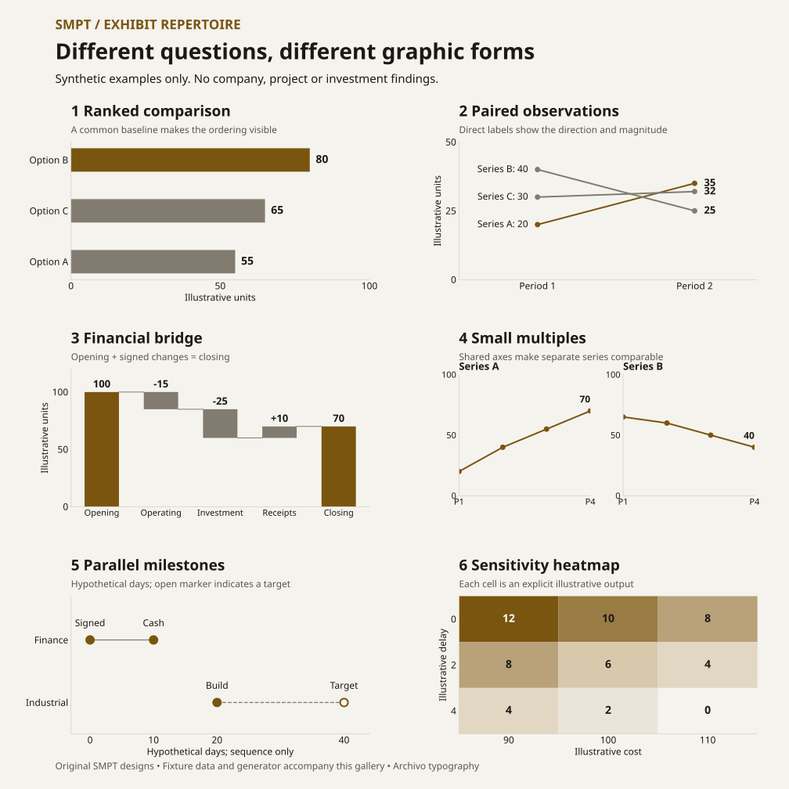

# SMPT visual repertoire and consulting references

Added 6 November 2026 · Applies to new and revised SMPT research decks. Read with [Presentation Standard](SMPT_PRESENTATION_STANDARD_V2.md), [Exhibit Rules](EXHIBIT_AND_CHART_RULES.md) and [Visual Integrity](EDITORIAL_AUTHENTICITY_AND_VISUAL_INTEGRITY.md).

## Direction

Use a broad repertoire of original graphics to sustain attention and make the argument easier to understand. Vary the exhibit structure, composition and density according to the reader's task. Keep Archivo, SMPT colors, source treatment and status vocabulary consistent across the deck.

Tables serve exact lookups and multidimensional comparison. They should earn their place against a visual alternative whenever the underlying question concerns timing, change, ranking, sensitivity, operating state or a physical/contractual relationship. A succession of prose-filled tables usually needs a composition review. A coherent series of comparable charts may intentionally repeat a form.

Attention comes from clear comparisons, revealing annotations and a developing argument. More colors, shapes, icons or chart types alone do not establish quality. Public consulting reports illustrate possibilities; they do not establish a universal client-deck formula or a quota for SMPT.

## Original SMPT examples

These six examples demonstrate form only. **All values, dates and states are synthetic layout fixtures, with no company, project, policy or investment finding.** They are original SMPT graphics, not reconstructions of a firm's exhibits. The [fixture data](examples/visual-repertoire-data.json) and [generator](examples/render_visual_repertoire.py) reproduce the SVG and PNG. Use native editable PowerPoint objects when adapting a pattern into a publication; a gallery screenshot is not an editable slide exhibit.

For deck production, the [exhibit system](exhibit-system/README.md) supersedes these six images. It has 38 registered patterns with native editable PowerPoint renderers, integrity checks and an editability report, also on synthetic data. The six SVG examples are kept as the original illustrations for this document.

## Public reference gallery

The links below point to publisher-hosted originals, retrieved and visually examined on 6 November 2026. PDF page numbers count the cover as page 1; printed page numbers are also supplied. No external PDF, screenshot, figure asset, logo or font binary is included in this repository. Page anchors apply to the exact linked edition, not to different supplied/abridged copies.

| Reference | Exact example | What to learn | SMPT application / boundary |
|---|---|---|---|
| [McKinsey, year in charts, 8 December 2025](https://www.mckinsey.com/featured-insights/year-in-review/year-in-charts) | AI use across business functions: five aligned line-chart panels | Small multiples expose differences using repeated scales and direct labels | Compare several genuine, comparable series. Keep shared axes; do not invent additional observations to populate panels |
| [Same McKinsey collection](https://www.mckinsey.com/featured-insights/year-in-review/year-in-charts) | Passenger-car export rankings, 2019 versus 2024 | A two-period rank/value comparison makes changing positions visible | Use a slope/rank comparison when endpoints and populations are comparable; the connecting line does not establish a cause |
| [BCG and SIA, semiconductor design leadership, November 2022](https://web-assets.bcg.com/3f/b4/fd384ccd46dc8a381bd61a648105/bcg-the-growing-challenge-of-semiconductor-design-leadership-nov-2022-r.pdf#page=16) | PDF p16 / printed p14, Exhibit 6: design cost across technology nodes | Zero-based, directly labeled bars plus one span annotation make the scale of change clear | Useful for project-cost or investment comparisons with matching definitions. Adapt the comparison, not BCG's colors or page composition |
| [Bain, Global Private Equity Report 2025](https://www.bain.com/globalassets/noindex/2025/bain-report_global-private-equity-report-2025.pdf#page=44) | PDF p44 / printed p42, software-investing Figure 2 | A value-creation bridge and an adjacent contribution comparison answer related financial questions | Use a bridge for an additive reconciliation, then a separate comparable mix if needed. Preserve the distinct denominators |
| [Strategy&, Maximizing the Value of Every Molecule, 2018](https://www.strategyand.pwc.com/m1/en/reports/maximizing-the-value-of-every-molecule.pdf#page=13) | PDF/printed p13, Exhibit 5: value-chain network and model structure | Connections and modules explain relationships that a prose table would obscure | Map documented material flows or contractual dependencies. Label arrow meaning; keep magnitude unencoded unless evidenced |
| [Same Strategy& report](https://www.strategyand.pwc.com/m1/en/reports/maximizing-the-value-of-every-molecule.pdf#page=14) | PDF/printed p14, Exhibit 6: option comparisons | Small comparable bar exhibits sit beside explicit capital and implementation criteria | Combine modeled economics with separately labeled qualitative criteria. Avoid invented NPV or subjective numerical scores |

These are public research/report examples, including portrait pages. SMPT adapts their analytical principles to its own 16:9 presentations. Dense report text, animated web graphics and another firm's branding are not automatic slide requirements. Keep the [older reference analysis](REFERENCE_ANALYSIS.md) as historical design research; the current Archivo standard controls typography.

## Working repertoire

Choose a form after defining the relationship. Several families can serve the same question; select the one that makes the important comparison easiest to see.

| Reader task | Useful forms | Data / interpretation guardrail |
|---|---|---|
| Compare amounts or rank choices | Horizontal bars, dot plots, lollipops | Common units and zero baseline for magnitude bars; label the actual basis |
| Compare two observations per entity | Dumbbells, slopegraphs, paired bars | Same population/definition; endpoints are observations rather than an interpolated forecast |
| Compare several time series | Small multiples, direct-labeled lines | Shared scales when comparing magnitude; actual time spacing; distinguish targets and forecasts |
| Explain composition | Segmented bars, 100% bars | A real common denominator; no stacking cash with conditional capacity |
| Reconcile a changing balance | True waterfall, sources-and-uses bridge | Every movement ties; opening/closing on consistent bases; small bars retain true geometry |
| Identify sensitivity drivers | Tornado, driver bridge | State baseline, changed driver/range and standalone versus combined effects |
| Show interactions or thresholds | Sensitivity heatmap, scenario grid, contour only with supported model | Cells must reproduce from a real model; no arbitrary risk-score colors |
| Compare two quantitative dimensions | Scatterplot; sized bubbles if a third measure matters | Evidence-backed axes; bubble area proportional to its measure; no invented category coordinates |
| Explain dated events and parallel obligations | Timeline, swimlanes, maturity ladder | Separate actual, contractual, assumed and expected dates; label equal-spaced schematics |
| Explain conditional entitlement or operating state | State diagram, branching condition tree, state-specific bars | State conditions and missing/inapplicable values; arrows do not imply automatic progress |
| Explain flows and dependencies | Value-chain map, instrument/beneficiary network, Sankey only for quantified flows | Define direction; width requires comparable flow evidence and reconciliation |
| Explain distributions and uncertainty | Dot distribution, box plot, interval/range chart | Appropriate sample and definitions; a range is not a probability distribution |
| Compare strategic options | Option profiles, criterion matrix, economics plus qualitative annotations | Consistent criteria; distinguish judgment from sourced or modeled measures |
| Locate assets or implementation constraints | Sourced map, annotated facility/process image | Verified geography/image provenance; location is not demonstrated capacity or production |
| Present a decision succinctly | One dominant exhibit with an interpretation column, ranked actions, concise executive readout | Evidence and owner/condition matter more than decorative KPI panels |
| Support precise lookup | Compact table, role matrix, contractual term comparison | Retain exact legal/financial distinctions; simplify cell prose before reducing font size |

## Plan and review the deck as a whole

Before production, extend the existing slide manifest/specification with each slide's reader question, relationship, proposed exhibit family, controlling data/source and material qualifications. This is part of the normal manuscript, not another competing tracker. If a table is selected for timing/change/state evidence, record why a visual alternative would be less clear.

Review a contact sheet alongside a headline-only reading. A run of three or more substantially identical compositions is a **review trigger**, not a failure or a quota: retain it when shared structure helps comparison; otherwise change the exhibit that most benefits from a different form. Changing only colors or icons does not resolve repetitive composition. Avoid adding filler slides to manufacture variety.

Check every slide at full size after export. Inspect whether the dominant comparison is visible quickly, annotations sit near the relevant evidence, source/qualification bands have enough separation, and displayed precision matches the decision. Small reconciliation movements can use direct labels or a detail inset with a clearly separate scale; never inflate their bars. Document these judgments in existing gates C (visual integrity) and E (publication coherence). Automated variety counts do not grant a PASS.

## Applying the repertoire to FI003

Useful candidates are a financing-sequence timeline (slide 3), a conditional covenant/milestone timeline (9), operating-state comparisons (11), and refinement of the complete liquidity waterfall (13). Tables remain useful for bank roles and exact contract comparisons. These are production options for its active branch, not changes to FI003 findings, model assumptions or published files. The separate FI003 tracker and exact-file publication gates continue to control that product.

## Production and rights

All quantitative exhibits must trace to the accepted model or sources. Preserve source facts, uncertainty, legal/financial status and original units when changing visual form. Keep data charts and explanatory diagrams editable in PowerPoint; include meaningful descriptions and sensible reading order, and tag decorative rules/connectors as artifacts in the PDF workflow. Verify native chart workbooks and exported links as applicable.

Link external examples with page/figure locators and explain the principle in original words. Create SMPT's own compositions. Public availability does not itself grant redistribution permission; reference images and complete originals stay outside the public repository. This guide authorizes no research finding, historical restyling, merge, deployment or public product release.
