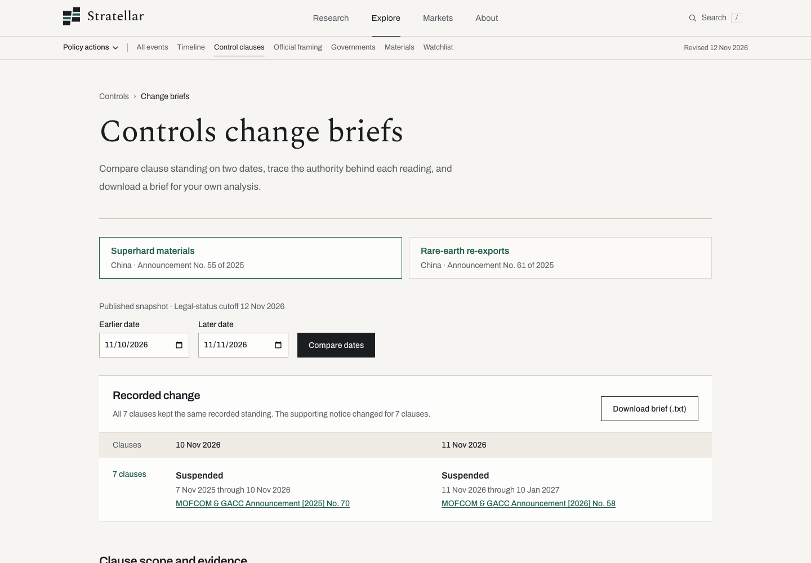
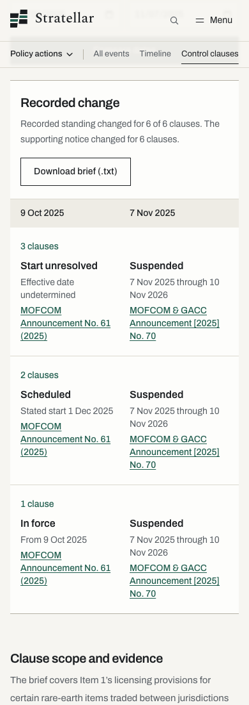

# Controls change briefs

## Product decision

| | |
| --- | --- |
| Buyer and recurring decision | A regulatory analyst at a supply-risk intelligence platform deciding whether a newly issued instrument warrants changing an internal control record, its review date, or the evidence sent to a sector analyst. |
| Existing process | Find the original notice and its predecessors, reconcile publication and operation dates, read the relevant provisions and annexes, then write a dated note or update a spreadsheet. Market intelligence services and policy trackers can supply context and discovery, while authority texts and internal research still carry the reconciliation. |
| Improvement | Compare what the public record supports on two dates at clause level. Separate a change of legal standing from a change of governing instrument, and take the evidence into a working note with the sources, relevant dates, and stable IDs intact. |
| Reuse | The published Controls snapshot and digest verification, #294’s baseline normalization and date replay, existing control and source dossiers, published research and the research inquiry contact. |
| Gap | Today the public Controls explorer shows status and a timeline, the dossier shows one clause at a time, and reproducible historical comparisons require offline tooling. The buyer lacks a focused cross-clause comparison and a portable, human-readable result. |
| Commercial hypothesis | An analyst will return after a consequential notice, use the brief in their own update, and consider licensing maintained clause histories if the comparison saves reconciliation time and its evidence stands up to review. Broader adoption remains a hypothesis. |
| Limits | Two selected instruments in a pinned historical release. Source publication approximates contemporaneous evidence and the archive can contain later curation. Annex completeness, transaction applicability and status beyond the cutoff require further evidence. |

Start with No. 55 of 2025 because a successor changes the controlling citation and end date while the clause status stays suspended. Use No. 61 of 2025 as a second case because its distinct legal mechanism and mixed initial standing exercise the same workflow, including an unresolved commencement date. The Industrial Execution Monitor (#280) remains under review. Controls supports a repeatable decision with the approved evidence already available. The financial aggregation guidance in #282 and consumer manifest in #284 address distinct needs. #295 preserves the issued ZIP and directs reconciliation of #283 with #294 before a separate targeted release.

Benchmark, S&P Global, Fastmarkets, and CRU set useful expectations for structured delivery, method and provenance, decision-specific exhibits, and coverage clarity. The position tested here is traceability of a specific legal change within a selected corpus. [Benchmark](https://www.benchmarkminerals.com/) · [S&P Global](https://www.spglobal.com/market-intelligence/en/campaigns/critical-minerals-intelligence) · [Fastmarkets](https://www.fastmarkets.com/metals-and-mining/battery-raw-materials/long-term-forecasts/) · [CRU](https://www.crugroup.com/en/commodities/battery-materials/)

## Evidence

- No. 55 of 2025 gives the six numbered item and licensing provisions, customs-declaration paragraph, and original scheduled start. [Original instrument](https://www.mofcom.gov.cn/zwgk/zcfb/art/2025/art_949f47563b834dad95b0010f375a892c.html)
- No. 70 of 2025 suspends both instruments through 10 November 2026. No. 58 of 2026 continues the suspension from 11 November 2026 through 10 January 2027. [Initial suspension](https://www.mofcom.gov.cn/zwgk/zcfb/art/2025/art_b1ec77dd3f0d4762952904df7cdaadec.html) · [Continuation](https://www.mofcom.gov.cn/zwgk/zcfb/art/2026/art_91466027f465467985942a639a9485f4.html)
- No. 61 of 2025 Item 8 dates Item 1(3) to publication and Items 1(1)–(2) to 1 December 2025. The public record keeps commencement unresolved for Items 2–4. The cited annex is outside the reviewed product coverage for this brief. [Original instrument](https://www.mofcom.gov.cn/zwgk/zcfb/art/2025/art_7fc9bff0fb4546ecb02f66ee77d0e5f6.html)

## Reproduce and review

```sh
npm ci
npm run build
npm run start -- --hostname 127.0.0.1 --port 4312
```

Start at [Controls](http://127.0.0.1:4312/controls) and choose **Open change briefs**. Try the [No. 55 comparison](http://127.0.0.1:4312/controls/changes/superhard-materials?from=2026-11-10&to=2026-11-11) or the [No. 61 comparison](http://127.0.0.1:4312/controls/changes/rare-earth-re-exports?from=2025-10-09&to=2025-11-07). Use **Download brief (.txt)** for the chosen dates. The note includes the instrument, clause, status-entry and source IDs, the snapshot digest, recorded scope, original authority URLs and questions to verify. It can be inspected in a text editor or pasted into working notes.

- **No. 55, 10–11 November 2026.** All seven clause records remain suspended. The governing notice changes from No. 70 of 2025 to No. 58 of 2026. The stated last day changes from 10 November 2026 to 10 January 2027. The continuation was published 9 November 2026 and operated from 11 November.
- **No. 61, 9 October–7 November 2025.** The first reading has one clause in force, two scheduled, and three with unresolved commencement dates. The later reading shows all six suspended. This records what the sources establish for the coded clauses. The case covers Items 1–4 and leaves the annex item list, other provisions and transaction application to further review.
- **Same workflow after an update.** In the No. 61 case, compare 10 and 11 November 2026. All six retain suspended standing while the governing notice and stated end change. When another snapshot is issued, a new case or edition can pin that archive in the case register and reuse the comparison and download. Keep the earlier case and its release pin to preserve reproducibility.

| Desktop · No. 55 | Mobile · No. 61 |
| --- | --- |
|  |  |

## Architecture and release boundary

Both the page and attachment use the same server-side projection. It reads and verifies the published archive, normalizes it with #294’s baseline builder, and calls its standing function for each selected day. Each date uses the status evidence published by that day. The result reflects the archive’s retrospective curation, and the timeline lists the full archived history. The comparison and download use the same validated date parameters. Date selection ends at the legal-status cutoff even when a notice states a later end date. The server rejects unknown cases and duplicate, invalid, reversed or post-cutoff dates. The native date form and clause disclosures also work with JavaScript off.

The workflow renders a human-readable excerpt for two selected instruments. The integration release, corpus, original ZIP, existing API contracts, researcher review files and legal-status cutoff retain their existing release controls. The case register accepts only pinned published archives. It does not expose a candidate mode or read staged records. Further commercial integration or redistribution requires separate permission. No Capital or Projects relationships are shown because the verified provisions here establish no such links.

The founder’s review should cover the two case descriptions, the unresolved-date and applicability wording, the text attachment’s research-use language, and the **Licensing and research inquiries** copy linking to the existing contact page. Named-human adjudication, candidate promotion, private feed distribution and any change to commercial terms remain separate decisions under #295. The visual reference was the published Escondida executive deck and the live Stratellar design system. A publication-cleared MP Materials carousel was not available in the authorized review materials.

## Buyer evaluation

Send the same task in an email or present it verbatim in a live session. Ask the buyer to work without a walkthrough first.

> It is 11 November 2026. Your database says the suspension of China’s No. 55 superhard-materials provisions runs through 10 November. Decide what you would change in your record today. Send a short update with the affected clauses, old and new end dates, the governing notices and what remains unverified.

1. Have the analyst describe or demonstrate how they ordinarily solve this with official sources, internal records, vendor alerts or spreadsheets. Record time to a defensible answer, sources consulted and where they needed another person or tool.
2. Share the Controls entry page. Ask them to locate the case, verify the two citations and return the attachment or the excerpt they would use. Record time, assistance needed and whether the result correctly distinguishes the unchanged suspension from the new authority and window.
3. Ask where they would put the output, what they would edit, and whether its IDs, date semantics and citations preserve an auditable update. Invite one concrete change that would make it usable in their own workflow.
4. Repeat use is evidenced by an unsolicited return on a subsequent notice or an actual request to test another internal update. Evidence of willingness to pay is a defined coverage and delivery request tied to a workflow owner, a budget discussion or a scoped evaluation with the buyer’s own data team. Favor further coverage, structured integration or deeper interpretation according to the friction observed in that evaluation.
