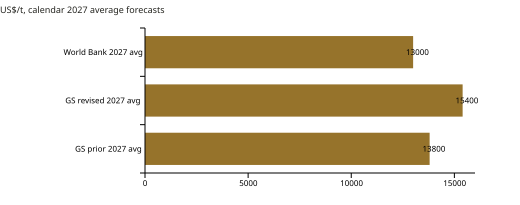
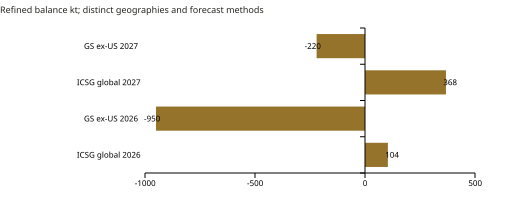
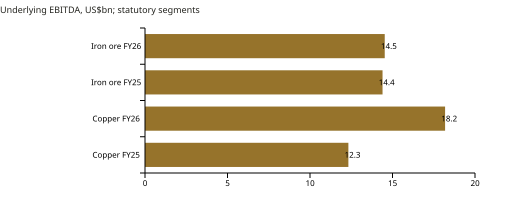
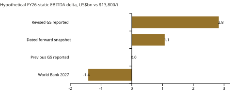
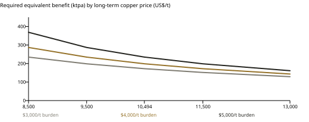
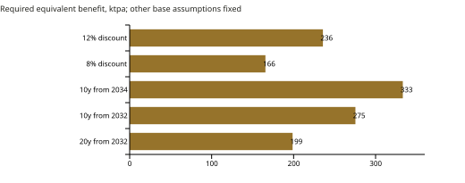
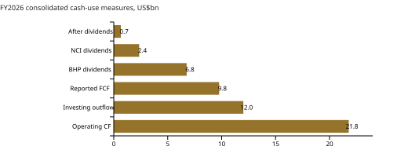

# Goldman Sachs' Copper Outlook and BHP's $6 Billion Escondida Decision

Near-term earnings exposure, replacement economics and the case for conditional investment readiness

Research cutoff: 5 November 2026. Independent SMPT research. Neither Goldman Sachs nor BHP commissioned, sponsored or endorsed this publication.

## Executive summary: copper prices widen BHP’s choices

### Research question

Goldman Sachs' bullish copper forecast and BHP's roughly $6bn Escondida investment belong in the same analysis because copper earnings help finance the company's next generation of assets. They operate on different clocks, however. Strong prices in 2027 could improve financial flexibility well before the New Concentrator begins producing in 2031-32. The investment question is how much that near-term improvement should influence a long-lived replacement decision whose value depends on what happens to the mine without it.

### Earnings exposure

Public reporting puts Goldman's 2027 average forecast at $15,400/t, raised from $13,800/t. Applying BHP's disclosed FY2026 price sensitivity to that revision gives a hypothetical $2.83bn underlying EBITDA differential; the gap to the World Bank's $13,000/t forecast gives $4.25bn. These amounts show that disagreement over copper prices is material at BHP's earnings scale. They do not forecast 2027 results or establish cash available to fund Escondida, where taxes, minority interests and other portfolio demands affect the amount management can deploy.

### Replacement economics

Escondida's New Concentrator replaces Los Colorados. Its disclosed 230-270ktpa facility output therefore includes production that may be preserved, and cannot be treated as wholly incremental mine output. SMPT's reverse appraisal asks what annual economic benefit would recover the assumed capital: about 199ktpa of copper-equivalent benefit in the base screen, 333ktpa with a shorter, later benefit period, and 416ktpa under combined stress. Those are tests of assumptions, not estimates of the project's benefit. Their variation exposes the importance of the missing no-build operating plan.

### Investment judgment

Maintain funded engineering, permitting and conditional final investment decision (FID) readiness, with selected acceleration where preparation resolves uncertainty or protects a credible replacement schedule. BHP's 16-18% return guidance uses a long-term price of about $10,494/t, well below Goldman's near-term forecast; its underlying annual cash flows are unavailable. The public record supports preserving the ability to invest, while a commitment to faster construction requires a costed comparison of continuity losses, alternative processing and execution risk.

Original finding | Financial significance
--- | ---
$2.83bn FY26-static EBITDA differential | Reported GS price revision at disclosed BHP exposure
$4.25bn same-scope spread | GS versus World Bank; no FCF conversion
199ktpa becomes 333ktpa in a shorter screen | Duration and the no-build baseline can dominate
Maintain funded readiness | Construction options need a verified counterfactual

Evidence: [S01](https://www.bhp.com/-/media/documents/media/reports-and-presentations/2026/260818_bhpresultsfortheyearended30june2026_presentation.pdf) / [S03](https://www.bhp.com/-/media/documents/investors/annual-reports/2026/260818_bhpannualreport2026.pdf) / [S16](https://www.goldmansachs.com/insights/goldman-sachs-exchanges/why-oil-prices-are-surging-despite-recovering-supply) / [S18](https://www.financialjuice.com/News/9812752/Goldman-Sachs-Copper---FJElite.aspx?xy=rss)

## Goldman’s near-term forecast has a different role from BHP’s planning price

The comparable annual-average forecasts are Goldman's reported $15,400/t for 2027 and the World Bank's $13,000/t October estimate, an 18.5% premium. The older Goldman average of $13,800/t measures the scale of the bank's revision. A $14,405/t forward observation in public coverage provides a dated October 19 market reference, with a different informational basis from either institutional forecast. The spread identifies a consequential range of price expectations; it does not establish which institution has the more reliable model.

Exhibit 2. Goldman’s reported annual average is 18.5% above the World Bank’s. BHP long-term planning prices are excluded from this same-horizon chart.

The original October 19 Goldman research note was not obtained. The annual-average attribution rests on substantive public reporting, including FinancialJuice and Reuters carried by Business Recorder, alongside WII and ICAA coverage. These accounts may draw on the same bank note and should not be counted as independent forecasts. Goldman's own October 23 Exchanges transcript records Daan Struyven's separate $15,600/t end-2027 view. That primary statement supports the bank's bullish position while leaving the proprietary note's annual-average figure dependent on attributed reporting.

BHP uses UBS May 2026 long-term consensus of $4.76/lb, approximately $10,494/t, for its New Concentrator return guidance. Its Copper cash-flow projections use $5.40/lb for FY2027-31 and $4.76/lb for FY2032-35. These assumptions concern different periods and purposes. A strong 2027 outcome could increase internally generated funds before major construction, but extending the same price through decades of project operation would require a separate view of supply, demand and costs. The bank call informs financing conditions more directly than it establishes the replacement asset's long-term return.

Evidence: [S12](https://thedocs.worldbank.org/en/doc/2ac43f46629cf90c2ea5b8929a343593-0050012026/original/CMO-October-2026.pdf) / [S16](https://www.goldmansachs.com/insights/goldman-sachs-exchanges/why-oil-prices-are-surging-despite-recovering-supply) / [S18](https://www.financialjuice.com/News/9812752/Goldman-Sachs-Copper---FJElite.aspx?xy=rss) / [S20](https://www.brecorder.com/news/40445090/copper-flat-as-china-caution-outweighs-us-stockpiling-goldman-upgrade)

## Inventory location helps explain the competing copper outlooks

ICSG's October 14 release projects global refined surpluses of about 104kt in 2026 and 368kt in 2027, while public Goldman reporting describes deficits outside the United States of 950kt and 220kt. These forecasts use different geographic boundaries and methods, so their difference cannot be treated as an implied US surplus. They nevertheless direct attention to an economic mechanism that an aggregate balance can obscure: adequate global metal does not guarantee ready availability in every consuming region.

Exhibit 3. Global and ex-US balances describe distinct markets. Their difference is not an estimated US surplus.

Goldman's public explanation links US import and stockbuilding incentives to prospective tariffs, alongside Chinese scrap weakness that increases demand for refined metal. Metal drawn into US warehouses can become less available elsewhere while remaining part of global stocks. Buyers competing for accessible supplies may therefore face tight conditions even when annual refined output exceeds measured use. If those inventory incentives reverse, regional availability could improve without requiring a collapse in electrification demand. The mechanism supports a case for strong prices, but also a route through which that strength could fade.

ICSG separately cautions that its China apparent-use calculation omits changes in unreported stocks. During stockbuilding or destocking, measured use can differ from underlying consumption, complicating any simple reading of a small projected surplus. For BHP, the resulting uncertainty reaches benchmark prices, physical premiums, freight and treatment terms. The model isolates benchmark-price exposure; it assigns no dollar profit to a tariff and does not equate duties on copper articles and derivatives with a blanket refined-metal tariff. A replacement project needs an operating case that can survive changes in the inventory cycle underlying near-term margins.

Evidence: [S16](https://www.goldmansachs.com/insights/goldman-sachs-exchanges/why-oil-prices-are-surging-despite-recovering-supply) / [S18](https://www.financialjuice.com/News/9812752/Goldman-Sachs-Copper---FJElite.aspx?xy=rss) / [S19](https://icsg.org/download/2026-10-14-press-release-icsg-copper-market-forecast-2026-2027/)

## Copper already accounts for more than half of BHP’s underlying EBITDA

BHP's FY2026 Copper segment generated $29.031bn of revenue and $18.187bn of underlying EBITDA, up from $22.530bn and $12.326bn in FY2025. EBITDA rose by $5.861bn while group copper production declined from 2.017Mt to 1.953Mt and the average realized price increased from $4.25/lb to $5.74/lb. The combination shows how large the financial exposure to copper has become. It does not attribute the whole earnings increase to price: costs, grades, sales timing and other effects would be needed for a complete causal bridge.

Exhibit 4. Copper EBITDA rose strongly while iron ore changed little. This is an observed result, not a causal price bridge.

BHP's disclosed 54% copper contribution uses the combined EBITDA of Copper, Iron Ore and Coal, excluding Group and unallocated items. On that denominator, copper contributes 54.2%; against reported Group EBITDA of $32.947bn, it contributes 55.2%. Scope also matters within the portfolio. Escondida is fully consolidated because BHP controls it despite holding a 57.5% economic interest, whereas Antamina is equity accounted. Asset-management tables and statutory segment reporting can consequently present different revenue and earnings boundaries. Applying one ownership haircut to all reported copper measures would distort the exposure.

That earnings concentration gives management a substantial reason to protect the reliability of existing copper operations. It also means a copper downturn can weaken internal funding just as capital programs require cash. Neither observation establishes that every additional copper investment outranks iron ore, potash, debt reduction or distributions. The relevant comparison is the benefit of the next commitment against its cost and risk. Escondida's historical earnings make continuity economically important, while the replacement decision still requires an estimate of how much of that continuity depends on the proposed plant.

Evidence: [S02](https://www.bhp.com/-/media/documents/media/reports-and-presentations/2026/260818_bhpresultsfortheyearended30june2026_exchangerelease.pdf) / [S03](https://www.bhp.com/-/media/documents/investors/annual-reports/2026/260818_bhpannualreport2026.pdf) / [S05](https://www.bhp.com/-/media/documents/media/reports-and-presentations/2026/261020_bhpoperationalreviewforthequarterended30september2026-pdf.pdf)

## Goldman’s revision implies a material change in BHP’s earnings exposure

BHP's FY2026 presentation discloses approximately $39m of underlying EBITDA sensitivity per US cent/lb of copper, referring to the existing portfolio and total exposed volume, excluding equity-accounted investments. Converting the reported Goldman revision of $1,600/t into 72.575 cents/lb and applying that sensitivity gives $2,830.416m. The $2,400/t Goldman-World Bank gap gives $4,245.625m on the same basis. Using one company-disclosed exposure measure makes the price comparisons economically interpretable without constructing an unsupported forecast of future production.

Exhibit 5. Original calculation using BHP’s disclosed FY26 sensitivity, relative to the older reported $13,800/t forecast. Not a 2027 earnings forecast.

The $2.83bn illustration is equivalent in scale to about 9% of BHP's $32.947bn FY2026 Group EBITDA; the $4.25bn spread is about 13%. These comparisons explain why the forecast debate matters to corporate finance. A price outcome of that magnitude could materially affect the resources generated by the existing portfolio and management's choices among investment, distributions and balance-sheet protection. The percentages describe relative scale only. Neither differential is an increment that can be added to historical earnings: $13,800/t is an earlier Goldman forecast, not BHP's FY2026 realized-price baseline.

Applying a local sensitivity across a large price change also assumes linear behavior and an unchanged portfolio. Future grades, sales volumes, contract exposure and price-linked costs could alter the response. Even an EBITDA gain that did occur would pass through taxes, working capital, financing and minority distributions before becoming parent discretionary cash, while other commodities could move against it. The calculation therefore establishes the materiality of the financing scenario. It supplies no standalone project allowance, forward free-cash-flow (FCF) forecast or reason to relax Escondida's investment test.

Evidence: [S01](https://www.bhp.com/-/media/documents/media/reports-and-presentations/2026/260818_bhpresultsfortheyearended30june2026_presentation.pdf) / [S03](https://www.bhp.com/-/media/documents/investors/annual-reports/2026/260818_bhpannualreport2026.pdf) / [S12](https://thedocs.worldbank.org/en/doc/2ac43f46629cf90c2ea5b8929a343593-0050012026/original/CMO-October-2026.pdf) / [S18](https://www.financialjuice.com/News/9812752/Goldman-Sachs-Copper---FJElite.aspx?xy=rss)

## Volume and realized prices qualify the earnings opportunity

A second exposure calculation tests how the result changes when scaled to FY2027 asset guidance. Consolidated operation midpoints total 1.575Mt; assumed 95% payable/sales conversion and 5% price-linked leakage produce $2.394bn of gross sales exposure and a $2.274bn EBITDA proxy for the same $1,600/t price difference. The EBITDA proxy is about 19.6% below the issuer-based illustration. That gap is useful because it shows how sensitive an apparently straightforward price calculation becomes once forward volumes and conversion assumptions enter it.

Equality should not be expected. BHP's sensitivity describes historical FY2026 exposure, while the proxy uses a future fiscal-year production guide and assumed sales and cost responses. Published group production combines 100% subsidiaries with BHP-share equity-accounted output; the asset midpoint sum, with Antamina separately included, is also 20kt below the group guidance midpoint. These reporting differences do not justify a plug to force reconciliation. Without exposed-sales and contract detail, the disclosed sensitivity remains the stronger first-pass measure. The proxy's further $1.48bn cash conversion adds an assumed marginal tax rate and does not identify parent investment funds.

The latest quarter provides another constraint on the idea of a fresh windfall. BHP's provisional Q1 FY2027 realized copper price was $7.01/lb, about $15,454/t, close to Goldman's reported 2027 average, while production fell 19% year on year to 400.7kt. Realized pricing includes finalization effects and is not an LME annual benchmark, but the comparison changes the emphasis: Goldman's outlook may imply persistence of recently strong pricing more than another large step-up from it. Protecting volumes and operating continuity could consequently matter as much as obtaining a still higher price.

Comparison | Scope / result
--- | ---
Issuer FY26 sensitivity | Existing consolidated exposure; $2.830bn EBITDA illustration
Illustrative FY27-scale proxy | 1.575Mt x95% sales x95% pass-through; $2.274bn
Exact reconciliation | Unavailable: contracts, exposed sales and response differ
Decision use | Lead with issuer sensitivity; no inferred funding forecast

Evidence: [S01](https://www.bhp.com/-/media/documents/media/reports-and-presentations/2026/260818_bhpresultsfortheyearended30june2026_presentation.pdf) / [S03](https://www.bhp.com/-/media/documents/investors/annual-reports/2026/260818_bhpannualreport2026.pdf) / [S05](https://www.bhp.com/-/media/documents/media/reports-and-presentations/2026/261020_bhpoperationalreviewforthequarterended30september2026-pdf.pdf)

## Escondida’s replacement scope defines the investment problem

The proposed New Concentrator replaces Los Colorados, linking BHP's corporate exposure to a specific physical constraint. March disclosure described $4.4-5.9bn of capital and 220-260ktpa of copper output. By August the ranges were $5.4-6.3bn and 230-270ktpa, with throughput increased 10% to 50Mtpa. The capital midpoint rose 13.6%, from $5.15bn to $5.85bn, against a 4.2% increase in the output midpoint. Design maturity and scope changed, so this comparison alone cannot establish a construction overrun or deterioration in returns.

The budget is gross. BHP's 57.5% interest, alongside Rio Tinto's 30% and combined JECO interests of 12.5%, gives a simple BHP pro rata economic cost of $3.105-3.623bn, not a verified parent contribution schedule. August's approximately $0.5bn readiness figure is BHP share and October's $0.8bn is gross; they are not additive and neither constitutes full project approval. BHP targets FID in CY2027-28 and first production in CY2031-32. These distinctions separate spending that prepares the decision from the much larger commitment still to be made.

The indexed Chilean environmental file remains under evaluation with RCA pending. It records October 9 additional questions, an October 14 extension and a November 4 applicant request to extend suspension. The last is a request rather than evidence of a grant. Inaccessible substantive October official documents prevent an assessment of conditions or delay probability. More fundamentally, the investment comparison needs a mine plan showing output lost without replacement, ore that alternative circuits could process, and sustaining or retirement costs. The facility's 230-270ktpa is neither wholly incremental mine production nor evidence that replacement creates no new economic benefit.

Development milestone | Evidence and financial meaning
--- | ---
17 March 2026 announcement | $4.4-5.9bn; replacement plan
18 August investor estimates | $5.4-6.3bn nominal; 16-18% issuer IRR
20 October operating review | $0.8bn gross readiness approval; full FID still ahead
4 November filing indexed | Applicant extension request; no inferred approval
CY2027-28 / CY2031-32 | Target FID / first production, subject to gates

Evidence: [S01](https://www.bhp.com/-/media/documents/media/reports-and-presentations/2026/260818_bhpresultsfortheyearended30june2026_presentation.pdf) / [S05](https://www.bhp.com/-/media/documents/media/reports-and-presentations/2026/261020_bhpoperationalreviewforthequarterended30september2026-pdf.pdf) / [S06](https://www.bhp.com/what-we-do/global-locations/chile/escondida) / [S07](https://www.bhp.com/news/articles/03/escondida--bhp-submits-environmental-permit-to-build-a-new-concentrator-plant) / [S17](https://ambihub.cl/seia/proyecto/2167965265)

## Reverse appraisal identifies the annual benefit the capital must earn

BHP reports a 16-18% project IRR, but the public record lacks the annual cash-flow schedule needed to reproduce it. SMPT instead asks a narrower question: what levelized annual benefit would recover assumed capital at a chosen discount rate? The screen uses $5.85bn of nominal gross capital in five equal year-end draws during 2027-31, a 10% nominal discount rate and 20 full benefit years beginning in 2032. At end-2026, capital has a present value of $4.435bn and the benefit annuity factor is 5.286, requiring $839m of after-tax annual benefit.

To express that financial requirement in operating terms, the screen combines $10,494/t copper with an assumed $4,000/t all-in net cash burden and a 35% cash-tax wedge. The resulting contribution is about $4,221/t; dividing the annual requirement by it gives 198.8ktpa of copper-equivalent benefit. Price, burden and contribution are held flat in nominal dollars, with no ramp-up or terminal value. This is a simplifying levelized convention, not an inflation-adjusted operating forecast. The burden is not Escondida's reported C1 cost or an engineering estimate, and the tax wedge does not model depreciation or the full fiscal regime.

The equivalent benefit concerns production preserved or added relative to no build. It is not facility output, a required recovery percentage or an independently estimated mine benefit. A complete comparison would also credit avoided old-plant spending and cost differences on output produced either way, and account for by-products, closure, working capital, leases and commitments. Those cash effects can change the result without changing tonnes. The full budget is retained because readiness approval does not disclose a reliably sunk amount; an actual sanction appraisal would identify sunk spending and remaining commitments separately.

Screen input or result | Base case
--- | ---
Gross nominal capital / present value | $5.850bn / $4.435bn
Discount / benefit convention | 10% nominal / 20 full years from 2032
Required annual after-tax benefit | $839m
Assumed after-tax contribution | $4,221/t at $10,494 price and $4,000 burden
Equivalent benefit / facility midpoint | 198.8ktpa / 250ktpa; counterfactual unmeasured

Evidence: [S01](https://www.bhp.com/-/media/documents/media/reports-and-presentations/2026/260818_bhpresultsfortheyearended30june2026_presentation.pdf)

## Benefit duration and contribution margin drive the capital-recovery screen

The base requirement of about 199ktpa is roughly 80% of the facility midpoint of 250ktpa. That comparison makes the assumption demanding enough to investigate, but it cannot determine viability: the actual difference between build and no build has not been measured. Under $8,500/t long-term copper, 20% higher capital and two years of benefit deferral with capital timing fixed, the requirement rises to 416ktpa. Exceeding facility output in that screen flags reliance on other benefits or different assumptions; it does not independently prove that the actual project destroys value.

Exhibit 9. Required equivalent benefit changes with both price and the assumed net cash burden. All curves use five equal capital draws, 20 benefit years and a 10% discount rate.

Duration explains much of the variation. Reducing the benefit period from 20 years to ten, still beginning in 2032, raises the requirement from 199ktpa to about 275ktpa. Starting those ten years in 2034 raises it further to 333ktpa because unchanged construction spending is followed by a longer wait for benefits. BHP discloses average facility output over FY2034-43, which does not substantiate 20 flat benefit years. The shorter screen neither forecasts a ten-year mine life nor matches fiscal and calendar years exactly. It shows why extrapolating a disclosed averaging window into a long operating profile can materially affect an appraisal.

The price-cost frontier supplies the complementary explanation. At the base long-term price, reducing the net burden to $3,000/t lowers the requirement to about 172ktpa; raising it to $5,000/t increases it to about 235ktpa. Each tonne then contributes less toward the same capital requirement, and the required equivalent rises increasingly quickly as price approaches burden. Management's evidence must therefore link annual preserved production to a credible contribution margin and duration. An isolated production figure, however plausible physically, cannot complete the financial case.

Evidence: [S01](https://www.bhp.com/-/media/documents/media/reports-and-presentations/2026/260818_bhpresultsfortheyearended30june2026_presentation.pdf)

## The cost of delay depends on what happens to existing production

Schedule changes have different economic effects depending on which cash flows move. If capital is spent as planned but benefits arrive a year later, the model's 10% discount rate raises the equivalent-benefit requirement by 10%, to 219ktpa. A deliberate deferral that shifts both spending and benefits changes a different comparison. The distinction matters at a replacement asset: a later commissioning date can leave a gap in processing capacity even when the present value of construction spending also falls.

Exhibit 10. The disclosed FY34-43 averaging window does not substantiate twenty flat benefit years. All results are hypothetical screens.

In the stylized option equations, moving both capital and benefits by the same interval makes their common discount factor cancel exactly. A 10% acceleration premium therefore increases the required annual benefit by 10%, and a 5% staging escalation increases it by 5%. Those identities expose the assumptions rather than rank the alternatives. Actual acceleration could avoid lost production, while deferral could allow useful information to arrive or preserve cash for another obligation. Neither effect is valued by shifting two otherwise unchanged schedules.

For scale, 125kt of production lost for one year at the base assumed margin would represent about $528m of after-tax benefit. This is an input illustration, not a Los Colorados decline forecast. Its relevance depends on whether the mine could reroute ore or sustain existing capacity at lower cost, and whether an interruption would last one year or several. The next expenditure should help resolve those operating alternatives. Engineering definition, permitting responses, long-lead assessment and safe interface planning can protect a feasible schedule before BHP commits to faster construction; their scope and cost still require normal investment discipline.

Evidence: [S01](https://www.bhp.com/-/media/documents/media/reports-and-presentations/2026/260818_bhpresultsfortheyearended30june2026_presentation.pdf) / [S05](https://www.bhp.com/-/media/documents/media/reports-and-presentations/2026/261020_bhpoperationalreviewforthequarterended30september2026-pdf.pdf) / [S17](https://ambihub.cl/seia/proyecto/2167965265)

## Reported cash generation provides flexibility within portfolio obligations

BHP generated $21.778bn of operating cash flow in FY2026 and incurred $12.011bn of net investing outflow, leaving $9.767bn of reported FCF. Cash dividends of $6.756bn to BHP holders and $2.355bn to non-controlling interests (NCI) left $0.656bn before other financing items. The year demonstrates substantial cash generation alongside substantial existing uses. That small historical subtotal does not establish a financing shortfall: distribution choices, subsequent earnings, cash balances and borrowing affect future flexibility. Equally, the operating cash inflow cannot all be treated as money available for another project.

Exhibit 11. Reported FY26 FCF already includes investing outflows. Cash after dividends is a historical subtotal before other financing, not future project funding.

The $4.3bn Antamina silver-streaming receipt was a financing inflow associated with a liability, outside FCF. It improved liquidity and net debt while encumbering future by-product economics, so it cannot be treated as recurring operating generation. Reported net debt of $8.694bn, cash of $18.532bn and an undrawn $5.5bn revolving credit facility describe further flexibility. Cash includes restrictions and subsidiary interests; a net-debt target is a policy choice rather than committed credit. These resources can bridge timing differences, but their use still competes with distributions, other investments and balance-sheet resilience.

BHP's own Copper projections indicate about $12bn of cumulative attributable FCF in FY2027-31 and $24bn in FY2032-35. They already include modeled capital and NCI distributions, with specified centralized interest and taxes outside segment figures; deducting New Concentrator capital again would double count it. The projections support management's self-funding case under its assumptions, without demonstrating funding in every year or stress scenario. With group capex and exploration guided at roughly $11bn annually through the medium term, Copper SA, Vicuña, Spence, potash and sustaining needs also compete for execution capacity. Jansen Stage 2's total estimate rose from $4.9bn to $6.9bn, but differently scoped project budgets cannot be added into a current funding gap or used to rank returns.

Evidence: [S01](https://www.bhp.com/-/media/documents/media/reports-and-presentations/2026/260818_bhpresultsfortheyearended30june2026_presentation.pdf) / [S02](https://www.bhp.com/-/media/documents/media/reports-and-presentations/2026/260818_bhpresultsfortheyearended30june2026_exchangerelease.pdf) / [S03](https://www.bhp.com/-/media/documents/investors/annual-reports/2026/260818_bhpannualreport2026.pdf)

## Fund readiness while testing the case for irreversible construction

Goldman's outlook matters because stronger copper earnings could give BHP more room to meet overlapping investment obligations without weakening its balance sheet. The report's exposure calculation establishes that this is a financially material possibility. Escondida's replacement need then gives that flexibility a concrete use: preserving the capacity to replace processing infrastructure before continuity becomes costly. Continue funded pre-FID readiness and protect the planned replacement timetable through permit, engineering and return gates. Each preparatory commitment should have a defined purpose, such as reducing scope uncertainty or avoiding a costed schedule bottleneck.

Faster construction would become financially persuasive if an annual operating plan showed unavoidable retirement losses whose discounted value exceeded the acceleration premium and additional execution risk. That case also needs approved permits, safe interfaces, supplier availability and a costed schedule. Staging or re-scoping becomes more attractive if alternative circuits protect production cheaply, the mature cost or recovery profile weakens returns, or irreversible works face material redesign risk. Portfolio constraints can reinforce either choice, but a low cash year alone cannot determine which project has the higher economic value.

The most valuable missing evidence is an annual with-build versus no-build mine plan covering payable copper, alternative processing, sustaining costs and closure, followed by the associated tax and capital schedule. It would allow BHP's actual continuity benefit to be compared with the requirements exposed by the reverse appraisal. Further near-term price targets are less likely to settle that decision. The defensible conclusion is to preserve investment readiness while requiring the replacement case to earn the larger commitment on its own operating economics, under prices and margins appropriate to its life.

Course of action | When financially defensible
--- | ---
Maintain readiness | Replacement need credible; preserve permitted engineering path
Accelerate selected work | Costed avoided continuity loss exceeds premium; safe and permitted
Stage or re-scope | Return/readiness gap persists and alternatives protect output
Defer major construction | Complete counterfactual demonstrates option value exceeds lost benefit

Evidence: [S01](https://www.bhp.com/-/media/documents/media/reports-and-presentations/2026/260818_bhpresultsfortheyearended30june2026_presentation.pdf) / [S03](https://www.bhp.com/-/media/documents/investors/annual-reports/2026/260818_bhpannualreport2026.pdf) / [S05](https://www.bhp.com/-/media/documents/media/reports-and-presentations/2026/261020_bhpoperationalreviewforthequarterended30september2026-pdf.pdf) / [S17](https://ambihub.cl/seia/proyecto/2167965265)

## Methodology, original contribution and research boundaries

SMPT's original contribution is to connect two decisions often discussed separately: how rival copper expectations change the scale of BHP's existing earnings exposure, and what operating benefit a replacement budget must generate. The first calculation uses an issuer-disclosed sensitivity; the second reverses a transparent capital-recovery equation. Together they explain why stronger near-term funding conditions can coexist with an unresolved construction decision. The 199, 333 and 416ktpa cases expose assumptions that management must substantiate, rather than supply an independent project valuation or investment rating.

The editable workbook retains six selectable cases, historical financials, a disclosed-sensitivity module and a separately labeled investment screen. Python independently sums annual discounted cash flows, while standalone CSVs reproduce the price, margin and duration exhibits. Calculations retain full precision until display, with year-end discounting from end-2026. Historical cash flow, cumulative management projections and hypothetical exposure measures remain separate. The earlier mixed-period forward funding residual is excluded because its cash-conversion and reporting-period assumptions created precision unsupported by the evidence.

BHP's annual report, results presentation and operating updates anchor corporate facts. Forecasts retain their institutional attribution and horizon; public secondary reporting supports Goldman's annual average, and the bank's transcript supplies a related end-year view. ICSG's balance uses its primary October release. Environmental status carries lower evidentiary weight because it relies on an indexed mirror. The evidence register and claim matrix record source access and locators, while methodology documents the assumed capital draws, flat nominal margins and simplified cash-tax treatment.

The research cutoff remains 5 November 2026. Missing no-build production, project fiscal and cash schedules prevent an independently valued investment or lending conclusion. The proprietary Goldman note remains unavailable, and administrative milestones require a source-status refresh before eventual release. The evidence supports the conditional corporate decision framework developed here; a definitive investment rating would require the missing operating and fiscal inputs. The methodology and quality-review record document the calculations and their verification.

Research result | Decision boundary
--- | ---
Comparable price-exposure calculation | FY26-static EBITDA illustration, not future FCF
Reverse appraisal of replacement benefit | No independently measured with/without-build production
Historical cash and management projections | Different periods and scopes stay separate
Conditional readiness framework | Construction options require a complete counterfactual

Evidence: [S01](https://www.bhp.com/-/media/documents/media/reports-and-presentations/2026/260818_bhpresultsfortheyearended30june2026_presentation.pdf) / [S03](https://www.bhp.com/-/media/documents/investors/annual-reports/2026/260818_bhpannualreport2026.pdf) / [S16](https://www.goldmansachs.com/insights/goldman-sachs-exchanges/why-oil-prices-are-surging-despite-recovering-supply) / [S18](https://www.financialjuice.com/News/9812752/Goldman-Sachs-Copper---FJElite.aspx?xy=rss) / [S19](https://icsg.org/download/2026-10-14-press-release-icsg-copper-market-forecast-2026-2027/)

## Inspect the evidence and reproduce the analysis

The evidence register distinguishes source documents from access attempts. The claim matrix links major conclusions to document locators and separates reported facts, forecasts and original assumptions. Original bank research is not redistributed.
- S01 / BHP. [FY2026 results presentation](https://www.bhp.com/-/media/documents/media/reports-and-presentations/2026/260818_bhpresultsfortheyearended30june2026_presentation.pdf). 2026-08-18. Slides 19-22, 28, 35-36, 40, 48, 50. Verified primary.
- S02 / BHP. [FY2026 results exchange release](https://www.bhp.com/-/media/documents/media/reports-and-presentations/2026/260818_bhpresultsfortheyearended30june2026_exchangerelease.pdf). 2026-08-18. PDF pp. 4-5, 7, 19, 21-24. Verified primary.
- S03 / BHP. [Annual Report 2026](https://www.bhp.com/-/media/documents/investors/annual-reports/2026/260818_bhpannualreport2026.pdf). 2026-08-18. PDF pp. 22, 30, 36-37, 132, 136, 153, 163-165. Verified primary, selected sections.
- S05 / BHP. [September 2026 quarterly operational review](https://www.bhp.com/-/media/documents/media/reports-and-presentations/2026/261020_bhpoperationalreviewforthequarterended30september2026-pdf.pdf). 2026-10-20. PDF pp. 1-2, 5. Verified primary.
- S06 / BHP. [Escondida asset page](https://www.bhp.com/what-we-do/global-locations/chile/escondida). Undated; retrieved 2026-11-04. Escondida at a glance. Verified primary.
- S07 / BHP. [Environmental permit submission announcement](https://www.bhp.com/news/articles/03/escondida--bhp-submits-environmental-permit-to-build-a-new-concentrator-plant). 2026-03-17. Project description. Verified primary.
- S08 / World Investment Institute. [Copper: Goldman Sachs Raises Price Forecast on US-China Competition](https://wiinstitute.org/copper-goldman-sachs-raises-price-forecast-on-us-china-competition/). 2026-10-25. Forecast table; market mechanisms; risks. Verified public secondary, original unavailable.
- S09 / International Copper Association Australia. [Copper Weekly Brief - 22 October 2026](https://copper.com.au/news/mining/copper-weekly-brief-22-october-2026/). 2026-10-22. Supply and demand outlook table. Verified public secondary.
- S12 / World Bank. [Commodity Markets Outlook, October 2026](https://thedocs.worldbank.org/en/doc/2ac43f46629cf90c2ea5b8929a343593-0050012026/original/CMO-October-2026.pdf). 2026-10-27. Table 1, PDF p.21 (printed p.13). Verified primary.
- S16 / Goldman Sachs. [Exchanges: Why Oil Prices Are Surging Despite Recovering Supply](https://www.goldmansachs.com/insights/goldman-sachs-exchanges/why-oil-prices-are-surging-despite-recovering-supply). 2026-10-23. Transcript, copper exchange with Daan Struyven. Verified primary transcript.
- S17 / Ambi / SEA indexed documents. [Escondida SEIA file 2167965265](https://ambihub.cl/seia/proyecto/2167965265). Retrieved 2026-11-05. Project metadata; ICSARA2; extension request. Mirror inspected; underlying October text inaccessible.
- S18 / FinancialJuice. [Goldman Sachs: Copper - FJElite](https://www.financialjuice.com/News/9812752/Goldman-Sachs-Copper---FJElite.aspx?xy=rss). 2026-10-20. 20Oct 08:37 article body. Substantive public secondary text inspected.
- S19 / ICSG. [Copper Market Forecast 2026/2027](https://icsg.org/download/2026-10-14-press-release-icsg-copper-market-forecast-2026-2027/). 2026-10-14. Linked two-page release, p.1 balance paragraph and methodology. Primary PDF body inspected via catalog download.
- S20 / Business Recorder / Reuters. [Copper flat as China caution outweighs US stockpiling, Goldman upgrade](https://www.brecorder.com/news/40445090/copper-flat-as-china-caution-outweighs-us-stockpiling-goldman-upgrade). 2026-10-20. Goldman forecast paragraph. Public article inspected.

Working model: [Native Google Sheet](https://docs.google.com/spreadsheets/d/1MysAjBqAQ4-63XPo7YtncDle3q4faZDsBpTaVBWsg1k/edit?usp=drivesdk). Research baseline: [PR #202](https://github.com/VSSpowerlifting/strategic-materials-policy-tracker/pull/202). Supporting methods, evidence, calculations and the executive deck are included in the private delivery folder.

Supporting materials include the methodology, evidence register, claim-source matrix and reproducible calculation files. The source register records access limitations and document locators for further investigation.
